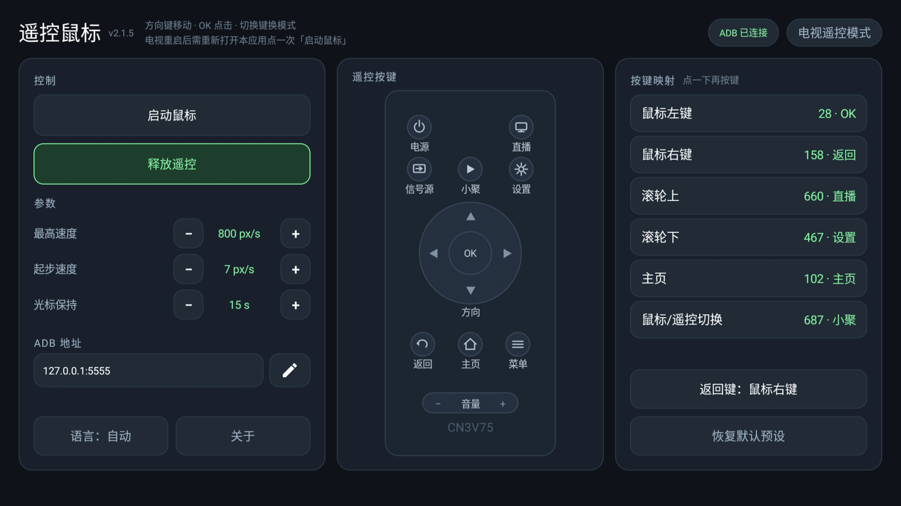
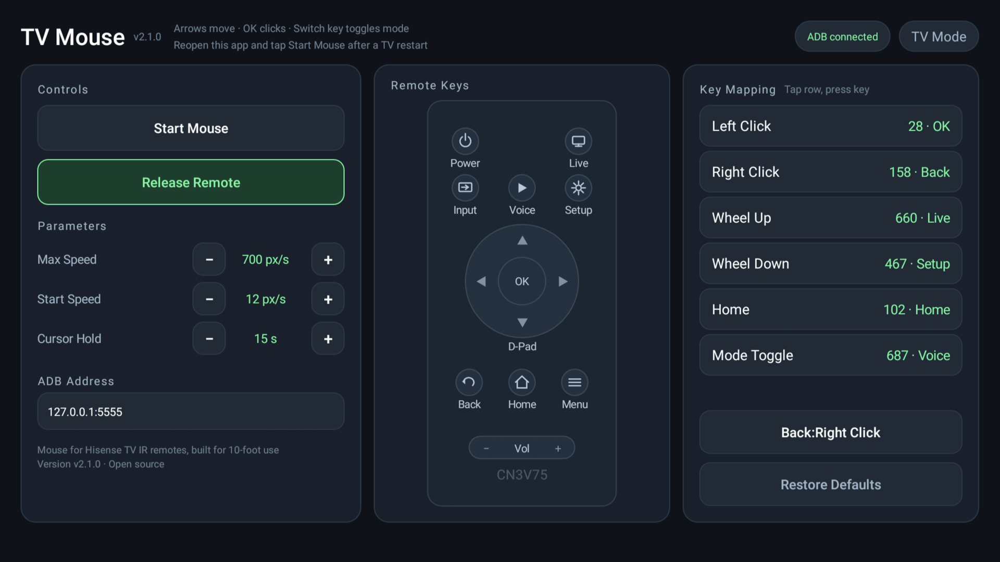

# TvMouse · 电视遥控鼠标

**中文** · [English](README.en.md)

用安卓电视原配的红外遥控器控制屏幕鼠标指针，**免 root、免无障碍授权**。

TVMouse 借助电视自带的 adb 调试能力，把红外遥控器按键换算成鼠标动作。

开发时适配了海信Vidda电视的红外遥控器。方便在安卓电视上安装使用安卓平板的影视、阅读和股票软件。

得益于AI做就的技术平权，本软件借助workbuddy和deepseek尝试各种路径并编写代码，成功开发TVmouse.



## 按键映射

| 遥控器按键 | 默认作用            |
| ----- | --------------- |
| 方向键   | 移动光标（轻点微调，长按加速） |
| OK    | 鼠标左键            |
| 返回    | 鼠标右键            |
| 直播    | 滚轮上             |
| 设置    | 滚轮下             |
| 小聚    | 鼠标 / 遥控模式切换     |

所有映射都可以在 App 里重新绑定。



## 安装

1. 电视打开「USB 调试 / ADB 调试」（海信：设置 → 关于 → 版本号连按开启开发者模式）。
2. 安装 `tvmouse-v2.1.5-release.apk`。
3. 打开 App → 点「启动鼠标」。首次连接电视会弹一次「允许 USB 调试」，勾选「一律允许」。
4. 停止：点「释放遥控」，或按切换键切回遥控模式。

## 从源码构建

需要 JDK 17 与 Android SDK（build-tools 34 / platform 34），Windows + Git Bash：

```bash
bash scripts/setup-toolchain.sh
bash scripts/build-release.sh 2.1.5 17 tvmouse-v2.1.5-release
```

构建脚本会在 `mousepad2/assets/` 自动生成 adb 密钥（不随仓库发布），并在构建后做隐私校验。

> `mousepad2/assets/tvmouse.bin` 是随包发布的预编译守护进程（v2.0.0，切换键双向可靠）；`native/tvmouse.c` 为源码参考，重新编译前请先验证切换键行为。

## 版本

- 当前：**v2.1.5**
- 发布版使用独立的 adb 密钥，首次安装需在电视上授权一次。

## 适配

- 已适配：海信 VIDDA-型号 CN3V75（0100）红外线遥控器。
- 其它品牌 / 型号：ADB 地址可改；遥控器键码可用 App 内的学习功能重新绑定。

## 许可证

GNU GPL v3.0，全文见 [LICENSE](LICENSE)。
